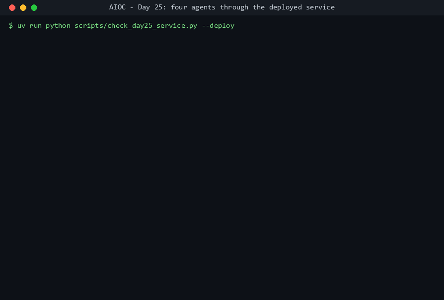
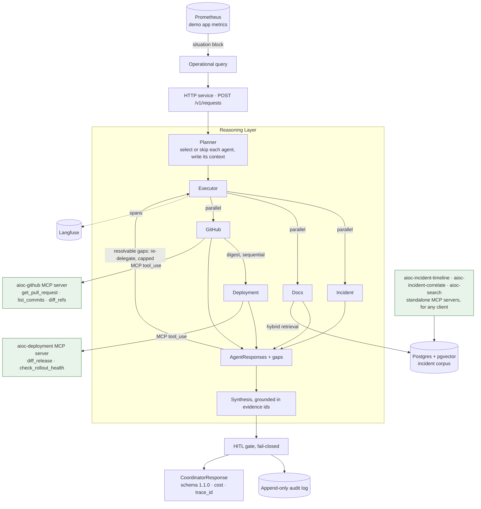

# AIOC - Enterprise AI Operations Center

A coordinator that dynamically routes operational questions to four deep subagents -
**Incident, Docs, GitHub, Deployment** - each producing schema-validated,
confidence-scored output through custom MCP tools.

> **Status: Day 26 of 30.** All four agents run live on one query, locally or through the orchestrator's own HTTP service in a container. The coordinator plans
> (dynamic selection and explicit context passing enforced by validators, not prompts),
> runs independent agents in parallel and dependent ones sequentially with a bounded
> handoff digest, re-delegates resolvable gaps in a capped refinement loop, and writes a
> synthesis that is grounded in code against the agents' evidence. Six contract-named MCP
> tools run as real stdio servers with a four-class error taxonomy, and every response is
> a schema-validated `CoordinatorResponse` with measured cost and a trace id; a major
> `schema_version` mismatch is refused. A report the contract or an agent's grounding
> rules refuse is re-requested with the error attached, and the outcome is recorded.
> Every recommended production write passes a fail-closed human-in-the-loop approval gate
> whose every decision is written to an append-only audit log before it is returned.
> Every judgement in a response is read back with its band and flagged where the band
> promises more evidence than the field cites; every Docs claim traces to the retrieval
> behind it, and every unanswered sub-question to the gap that reports it.
> An eval harness scores the shipped agents against the seeded incidents' recorded truth
> (accuracy, hallucination rate, tool success, calibration), with prompt caching on and
> the Batch API as a second way to run it. The committed baseline runs the set three
> ways: the scores agree within noise, caching takes 29% off the same tokens and the
> batch 61%. A stopped run is continued rather than repeated, and a batch outlives the
> process that submitted it.
> The orchestrator also runs as a containerised HTTP service (requests as jobs, closed
> until a token is set, live requests behind their own switch), with the schema applied as
> migrations.
> See [`EXECUTION_PLAN.md`](docs/EXECUTION_PLAN.md) for what lands when.

**Run it yourself:** [`docs/guides/quickstart.md`](docs/guides/quickstart.md) goes from
`git clone` to a fault injected and four agents diagnosing it. Everything up to the live
agents costs nothing.



*The Day 25 checkpoint, replayed from the run's own transcript. A real fault is injected, the
on-call suspects the last release, and one request to the orchestrator's HTTP service runs
four agents inside its container: the PR touched tracing code only, the release changed no
configuration or image, the latency comes from payments-api downstream, and every
recommended action is withheld by the approval gate. The same scenario run in process on
Day 15 is [`day15-demo.gif`](docs/assets/day15-demo.gif).*

---

## How it fits together



The two layers meet at a frozen JSON contract ([`docs/CONTRACTS.md`](docs/CONTRACTS.md)): Pydantic models on the reasoning side, JSON Schema across the MCP boundary.
Every arrow into an agent carries an explicit context block, and nothing is inherited.
The Incident agent has no tools: its live metrics arrive in the situation block the caller builds from Prometheus.
The GitHub and Deployment agents drive their servers over the real stdio wire; those servers read the GitHub API and, for rollout health, Prometheus.
The incident tool servers stand alone, for any MCP client: no agent drives them yet, and the two search tools are what the routing case study measures.
[`docs/assets/architecture.png`](docs/assets/architecture.png) is this diagram rendered, for slides and the video.

---

## Start here

| Document | What it answers |
|---|---|
| [`BUILD_PLAN.md`](docs/BUILD_PLAN.md) | What we're building, and why each piece exists |
| [`EXECUTION_PLAN.md`](docs/EXECUTION_PLAN.md) | Who builds it, on which day, and how we know it's done |
| [`docs/CONTRACTS.md`](docs/CONTRACTS.md) | **Frozen.** Every data shape crossing between the two layers |
| [`docs/guides/`](docs/guides/) | How-to guides: [quickstart](docs/guides/quickstart.md), [running the tests](docs/guides/running-tests.md), [the incidents table](docs/guides/incidents-table.md) |
| [`docs/interview-prep/`](docs/interview-prep/README.md) | War stories, decisions, and the measured numbers behind them |

`docs/CONTRACTS.md` is frozen at `1.1.0` (one pre-authorized tool split on Day 14). Changing anything in it requires a written
rationale recorded before the code changes, the superseded text struck through rather
than deleted, a version bump, and a changelog row.

---

## Running it locally

**Prerequisites:** Docker, [uv](https://docs.astral.sh/uv/), Python 3.12.

```bash
cp .env.example .env      # nothing needs filling in for the steps below
uv sync --all-groups
docker compose up -d --wait
```

Verify the stack is actually usable, not merely running:

```bash
make verify
```

That checks the stack is *usable*: containers healthy, the `vector` extension
installed, Redis answering, all three demo services exposing metrics, Prometheus
actually scraping them, and the incident corpus seeded and covering every failure
mode. The extension check matters because a plain `postgres` image starts perfectly
happily and then fails much later, inside the retrieval code - and the coverage check
matters because a failure mode with no seed rows cannot be scored by the eval at all.

No `make` on Windows? Every recipe in the [`Makefile`](Makefile) is a single
command you can paste directly, or install it with
`winget install ezwinports.make`.

### Useful commands

```bash
make up            # start the stack, wait for health
make down          # stop it, keep the data
make db-reset      # DESTRUCTIVE: drop volumes, re-run docker/postgres/init
make psql          # postgres shell
make lint          # ruff + mypy
make test          # unit tests only (skips those needing the stack)

make chaos-downstream-latency   # inject a failure mode (four exist; see the Makefile)
make chaos-reset                # return the demo app to a healthy baseline

# live checks (need ANTHROPIC_API_KEY in .env; these cost real tokens - the call count is
# in each script's docstring and in docs/guides/running-tests.md)
uv run python scripts/check_structured_output.py    # does diagnose() hold the contract, per model? (1/model)
uv run python scripts/check_day5_checkpoint.py      # chaos injected -> valid JSON, scored vs truth (1)
uv run python scripts/check_agent_selection.py      # coordinator routing (2 of 5 cases by default)

# see the whole system run: inject chaos, read Prometheus, respond() end to end (~3 calls)
PYTHONIOENCODING=utf-8 uv run python scripts/demo_day10.py
uv run scripts/render_demo_gif.py --run test-results/runs/<date>/<run-dir>   # free; the GIF
uv run python scripts/gate_recorded_run.py         # free; every recorded recommendation through the HITL gate
uv run python scripts/gate_recorded_run.py --persist   # free; the decisions written to the append-only audit log
uv run python scripts/audit_log.py                 # free; read the audit log back (--request, --decision, --since)
uv run python scripts/confidence_report.py         # free; every recorded judgement by band, flags, and the Docs claim -> source chain

# one agent at a time over the real MCP wire (each ~3-5 calls; GitHub ones need GITHUB_TOKEN)
PYTHONIOENCODING=utf-8 uv run python scripts/check_day11_github.py            # reads a real PR
PYTHONIOENCODING=utf-8 uv run python scripts/check_day12_deployment.py --deploy   # diffs two refs, reads the live rollout

# the sequential path: GitHub reads the PR, then Deployment gets GitHub's digest; since Day 14
# also the refinement loop and the model-written synthesis (~8-15 calls)
PYTHONIOENCODING=utf-8 uv run python scripts/check_day13_sequential.py --deploy

# all four agents on one query - the parallel and the sequential path in one request
# (~12-20 calls, ~$1.10 measured); then what every recorded live run has cost (free)
PYTHONIOENCODING=utf-8 uv run python scripts/check_day15_integration.py --deploy --max-rounds 1
uv run python scripts/cost_review.py

# the eval set: 38 items scored against the seed's answer key. The first four are free;
# a live run is one call an item (~$1.13 projected uncached, about half through the Batch API)
uv run python scripts/run_evals.py --list
uv run python scripts/run_evals.py --show case_04
uv run python scripts/run_evals.py --dry-run
uv run python scripts/run_evals.py --recorded-tools
PYTHONIOENCODING=utf-8 uv run python scripts/run_evals.py
PYTHONIOENCODING=utf-8 uv run python scripts/run_evals.py --mode batch
PYTHONIOENCODING=utf-8 uv run python scripts/run_evals.py --smoke      # 4 calls, a verdict

# the Day 20 baseline: the set three ways, side by side (118 calls, ~$2.95 projected)
uv run python scripts/check_day20_baseline.py --plan                   # free
PYTHONIOENCODING=utf-8 uv run python scripts/check_day20_baseline.py
uv run python scripts/eval_baseline.py --latest                        # free
PYTHONIOENCODING=utf-8 uv run python scripts/check_day20_baseline.py --resume --skip-smoke  # only what is left

# the routing case study: 20 queries per set, --dry-run is free; --variant v1_1 is the split
uv run python scripts/check_tool_routing.py --dry-run
uv run python scripts/check_tool_routing.py --variant v1_1 --dry-run

# the custom MCP tools, over stdio (free; each is a real server an MCP client can attach to)
uv run python -m aioc.tools.incident.timeline_server     # get_incident_timeline
uv run python -m aioc.tools.incident.correlate_server    # correlate_events
uv run python -m aioc.tools.incident.analyze_server      # analyze_logs, analyze_events (v1.0.0 baseline)
uv run python -m aioc.tools.incident.search_server       # search_container_logs, search_recorded_events (v1.1.0)
uv run python -m aioc.tools.github.server                # get_pull_request, list_commits, diff_refs
uv run python -m aioc.tools.deployment.server            # diff_release, check_rollout_health
```

`PYTHONIOENCODING=utf-8` matters on Windows: the console is cp1252 and a model's summary can
carry a character it cannot print. `--deploy` recreates the demo containers at the release
under test (the health tool reports whatever `DEMO_GIT_SHA` they were started with); a plain
`docker compose up -d --wait` afterwards puts them back on `baseline`. Every script records
its run under `test-results/`, so the response, the plan, and the tool replies are readable
after the fact.

### Test results

Every `pytest` run records itself under [`test-results/`](test-results/README.md) as JSON: what
ran, what failed, how long it took, and against which commit. Any other command can be wrapped:

```bash
uv run python scripts/runlog.py --kind lint --name ruff -- uv run ruff check .
grep '"outcome": "failed"' test-results/index.jsonl   # every failing run, newest last
```

The records are gitignored - they are machine-local evidence, not source. `AIOC_RUNLOG=0` opts
out. See that directory's README for the record schema.

---

## Layout

```
.claude/           rules, slash commands, skills, and the shared permission layer
src/aioc/
  contracts/       jointly owned - the executable form of docs/CONTRACTS.md
  llm/             Claude API harness - messages, streaming, the tool_use loop
  coordinator/     planner (selection) + executor (delegation, handoff, refinement loop) + synthesis
  agents/          incident · docs · github · deployment
  tools/           custom MCP servers - envelope, chaos policy gate, incident/ servers
  memory/          redis (working) · postgres (episodic) · pgvector (semantic)
  observability/   prometheus reads (live) · Langfuse tracing (Day 9)
  hitl/            human-in-the-loop approval gate and audit log
demo-app/          containerized services to break, plus chaos/ injection scripts
infrastructure/    Kubernetes manifests - documentation, not a deployment path
evaluations/       eval sets and committed results
scripts/           dev tooling - run logging, live API checks
test-results/      structured records of every run (gitignored; schema in its README)
```

`src/aioc/contracts/` is the one package both layers import. Note that the
MCP boundary is JSON Schema, not Pydantic - a tool server must not depend on the
reasoning layer's models. See §6 of the contract.

---

## Working on this repo with Claude Code

`.claude/` is committed on purpose - it's the Domain 3 evidence, not local scratch.
Path-scoped rules in `.claude/rules/` load only when you open a file they cover, so the
per-area conventions cost nothing on sessions that don't touch that area. `/contract`
surfaces the governing rules before you change part of the contract, and `/validate-schema`
checks a JSON payload against the Pydantic models.

`.claude/settings.json` is the shared permission layer: the inner dev loop runs without
prompting, the three destructive commands (`make db-reset`, `docker compose down -v`,
`git push`) prompt, and `.env`/`secrets/`/`*.pem`/`*.key` are unreadable. Your own
overrides go in `.claude/settings.local.json`, which is gitignored.

See [`docs/design-notes/domain-3-config-layer.md`](docs/design-notes/domain-3-config-layer.md)
for why each piece sits where it does.

---

## CCA-F domain evidence

Each domain below names the decision, the code that implements it, the test or measurement that proves it, and where the reasoning is written down.
Decision numbers refer to [`docs/interview-prep/decisions.md`](docs/interview-prep/decisions.md); measured numbers come from [`numbers.md`](docs/interview-prep/numbers.md).

| Domain | Weight | Implemented in | Design note |
|---|---|---|---|
| 1 - Agentic Architecture & Orchestration | 27% | [`src/aioc/coordinator/`](src/aioc/coordinator/) | decisions #3, #11, #15, #20, #22, #23, #28 |
| 2 - Tool Design & MCP Integration | 18% | [`src/aioc/tools/`](src/aioc/tools/), [`src/aioc/llm/mcp.py`](src/aioc/llm/mcp.py) | [`case-study-tool-routing.md`](docs/case-study-tool-routing.md), [`contract-changes.md`](docs/design-notes/contract-changes.md) |
| 3 - Claude Code Configuration & Workflows | 20% | [`.claude/`](.claude/), [`.github/workflows/`](.github/workflows/), [`.github/claude/review.md`](.github/claude/review.md) | [`domain-3-config-layer.md`](docs/design-notes/domain-3-config-layer.md), [`review-prompt-tuning.md`](docs/design-notes/review-prompt-tuning.md) |
| 4 - Prompt Engineering & Structured Output | 20% | [`src/aioc/agents/`](src/aioc/agents/), [`src/aioc/contracts/`](src/aioc/contracts/), [`src/aioc/evals/`](src/aioc/evals/) | [`CONTRACTS.md`](docs/CONTRACTS.md), decisions #2, #13, #21, #30, #34 |
| 5 - Context Management & Reliability | 15% | [`handoff.py`](src/aioc/coordinator/handoff.py), [`confidence.py`](src/aioc/coordinator/confidence.py), [`provenance.py`](src/aioc/coordinator/provenance.py), [`src/aioc/hitl/`](src/aioc/hitl/), [`src/aioc/llm/`](src/aioc/llm/) | decisions #25, #29, #31-#33, #35, #40, #43, [`model-routing.md`](docs/design-notes/model-routing.md) |

### Domain 1 - Agentic Architecture & Orchestration

A coordinator plans which of the four agents a query needs, then executes that plan.

- **Dynamic selection.** [`planner.py`](src/aioc/coordinator/planner.py) must account for all four agents: each is selected, or skipped with a reason, enforced by validators rather than prompt text (`test_plan_rejects_an_agent_that_is_neither_selected_nor_skipped` in [`tests/test_coordinator.py`](tests/test_coordinator.py)).
- **Explicit context passing.** Each agent receives `context_passed` and nothing else, and an empty context or one that only restates the query is a validation error (`test_subagent_receives_exactly_context_passed_and_nothing_else` in [`tests/test_executor.py`](tests/test_executor.py), `test_plan_rejects_context_that_only_restates_the_query`).
- **Parallel and sequential.** [`executor.py`](src/aioc/coordinator/executor.py) runs independent agents on a thread pool and dependent ones in order, each dependent handed a bounded digest of its dependency ([`handoff.py`](src/aioc/coordinator/handoff.py)) that is recorded verbatim on the invocation.
  A barrier test fails if the parallel group runs serially (`test_parallel_group_runs_concurrently`), and on the Day 25 run every pair in the parallel group overlapped in the Langfuse trace.
- **Refinement loop.** Open gaps that are `resolvable` and name a `suggested_agent` are re-delegated with their `suggested_query` verbatim, capped in rounds, and the same gap is never asked twice ([`tests/test_refinement.py`](tests/test_refinement.py)).
  An agent that does not exist yields a `resolvable: false` gap, never a fabricated report.
- **Synthesis as a seam.** The deterministic synthesis is the default; the model-written one is grounded in code against the agents' evidence ids and falls back to the deterministic form when rejected ([`synthesis.py`](src/aioc/coordinator/synthesis.py)).

### Domain 2 - Tool Design & MCP Integration

Six contract-named tools run as real stdio MCP servers, and two agents consume them over the wire.

- **Servers.** [`tools/incident/`](src/aioc/tools/incident/), [`tools/github/`](src/aioc/tools/github/), and [`tools/deployment/`](src/aioc/tools/deployment/) share one wire envelope ([`envelope.py`](src/aioc/tools/envelope.py)).
  They do not import the Pydantic models, because the MCP boundary is JSON Schema; a test holds their enum copies to the Python ones.
- **Four error classes.** `transient`, `validation`, `business`, and `permission` are each produced from a real code path and returned distinctly (`test_all_four_error_classes_return_distinctly`, in each tool's test module).
- **Descriptions.** Every tool description follows the four-part template: what it does, three example queries, edge cases, and when to use it instead of the named alternative.
- **The routing case study.** `analyze_logs` and `analyze_events` shipped deliberately overlapping, were measured, then split into `search_container_logs` and `search_recorded_events` through the contract's change process.
  The result was 0/40 misrouted before and after with Sonnet, and [the write-up](docs/case-study-tool-routing.md) says what that does and does not show.
- **Safety at the tool.** Config values are hashed at parse time and only keys are returned ([`release.py`](src/aioc/tools/deployment/release.py)), and the chaos ground truth is a `permission` error at every server ([`policy.py`](src/aioc/tools/policy.py)).

### Domain 3 - Claude Code Configuration & Workflows

The configuration is committed on purpose: it is the evidence, not local scratch.

- **Configuration.** A user, project, and directory `CLAUDE.md` hierarchy; seven path-scoped rules in [`.claude/rules/`](.claude/rules/); the `/contract` and `/validate-schema` commands; the `contract-audit` skill running read-only in a forked context; and [`.claude/settings.json`](.claude/settings.json) as the shared permission layer, where destructive commands ask and secrets are unreadable.
- **CI.** [`ci.yml`](.github/workflows/ci.yml) runs lint, mypy, and the offline suite of 1,122 tests on every pull request, with no secrets and no network.
- **Claude Code on pull requests.** [`claude-review.yml`](.github/workflows/claude-review.yml) runs a review or writes tests when a pull request is labelled.
  The review prompt names this repository's defect classes and allows "No defects found.", and generated tests are pushed only when they touch `tests/` alone and the suite passes.
  The prompt was tuned on scored local reviews.

### Domain 4 - Prompt Engineering & Structured Output

Every agent returns a contract-valid `AgentResponse` through a forced `tool_use`, never through parsed prose.

- **Schemas.** The emit tool's JSON Schema is generated from the frozen models and annotated with the cross-field rules a shape cannot state ([`_annotate.py`](src/aioc/agents/_annotate.py)): `null` versus `[]`, the `other` enum with its detail string, and the confidence bands, with a gap instead of a guess below 0.25.
- **The runtime owns facts.** Titles, SHAs, config keys, and health signals are stamped from tool replies, and a citation retrieval never returned or a paraphrased quote is refused in code ([`docs.py`](src/aioc/agents/docs.py), [`_toolset.py`](src/aioc/agents/_toolset.py)).
- **Validation-retry loop.** A refused report is answered in the same conversation with the rendered error, and the loop records whether each rejection was a format error or a grounding error ([`_retry.py`](src/aioc/agents/_retry.py)).
  In the Day 20 batch baseline, 7 of 38 items were recovered by a retry and none were given up on.
- **Evals.** [`src/aioc/evals/`](src/aioc/evals/) scores the shipped agents against the seeded incidents' recorded truth, read from the seed SQL, and a case whose context carries its own answer is refused at load.
  The results are below.

### Domain 5 - Context Management & Reliability

- **Context engineering.** Handoffs are bounded digests that keep the evidence ids when they cut.
  Tool replies are trimmed at the tool by extracting facts, -34% on the commit-bearing replies ([`commits.py`](src/aioc/tools/github/commits.py)).
  Every prompt puts stable reference first and the freshest signals and the query last.
- **Cost.** Prompt caching on the system block and the tool loop's tail took 29% off the same tokens and the Batch API 61% ([`evaluations/baseline.md`](evaluations/baseline.md)).
  The four-agent run went from $1.16 to $0.74 with caching and the sibling roster.
- **Provenance and confidence.** Every Docs claim traces to the retrieval call behind it and every unanswered sub-question to its gap, and every judgement is read back with its band and flagged where it claims more than it cites ([`provenance.py`](src/aioc/coordinator/provenance.py), [`confidence.py`](src/aioc/coordinator/confidence.py)).
- **Human in the loop.** Every recommended production write passes a fail-closed approval gate, and every decision is written to an append-only Postgres table before it is returned ([`src/aioc/hitl/`](src/aioc/hitl/)).

### Measured results

The eval set is 38 items over the 18 seeded incidents: each one as a diagnosis by the Incident agent and as a recall of its post-mortem by the Docs agent, plus two probes with no precedent.
Run three ways on `claude-sonnet-5` (Day 20, [`evaluations/baseline.md`](evaluations/baseline.md)):

| | realtime, uncached | realtime, cached | batch, cached |
|---|---|---|---|
| Failure mode correct | 15/18 | 16/18 | 17/18 |
| Severity within one level | 18/18 | 18/18 | 18/18 |
| Recall cites the post-mortem | 18/18 | 18/18 | 18/18 |
| Probes declined, no precedent invented | 1/1 | 2/2 | 2/2 |
| Ungrounded statements | 2/270 | 1/271 | 1/291 |
| Paid | $1.77 | $1.24 | $0.71 |
| Same tokens, against realtime uncached | - | -29% | -61% |

35 of the 38 items scored the same in every run, so the differences in the first row are the model answering identical requests differently, not the levers.
The Day 24 re-run ([`evaluations/day24-vs-baseline.md`](evaluations/day24-vs-baseline.md)) scored 16/18 and 18/18, within that noise.
What is not measured yet is listed plainly at the end of [`numbers.md`](docs/interview-prep/numbers.md#what-is-not-measured-yet).
